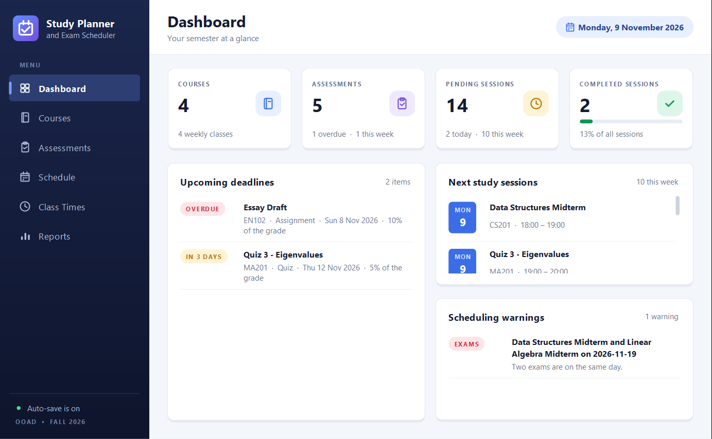
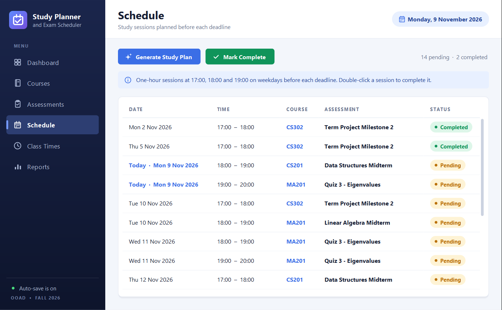
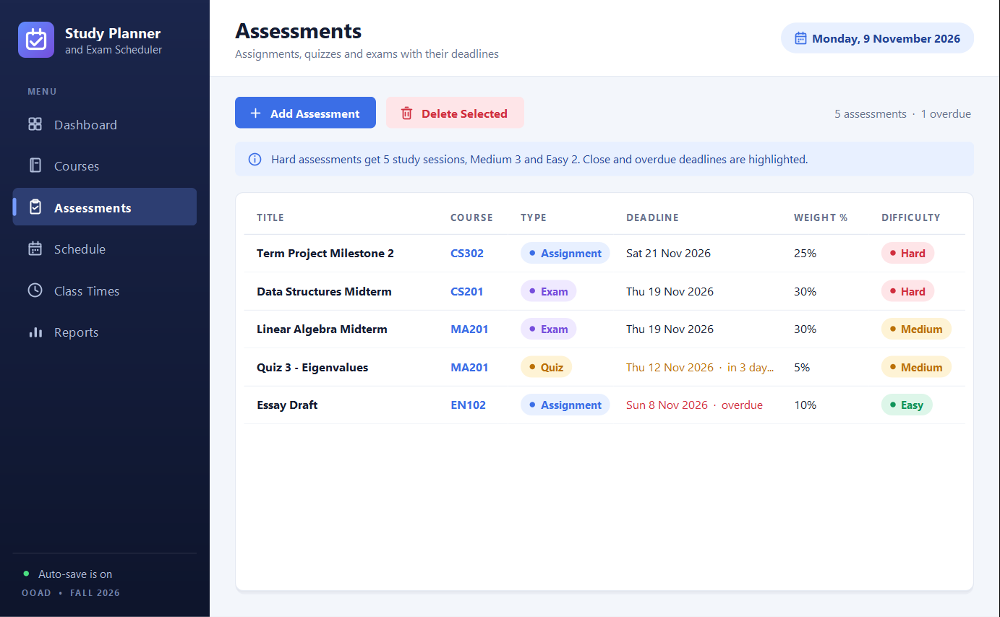
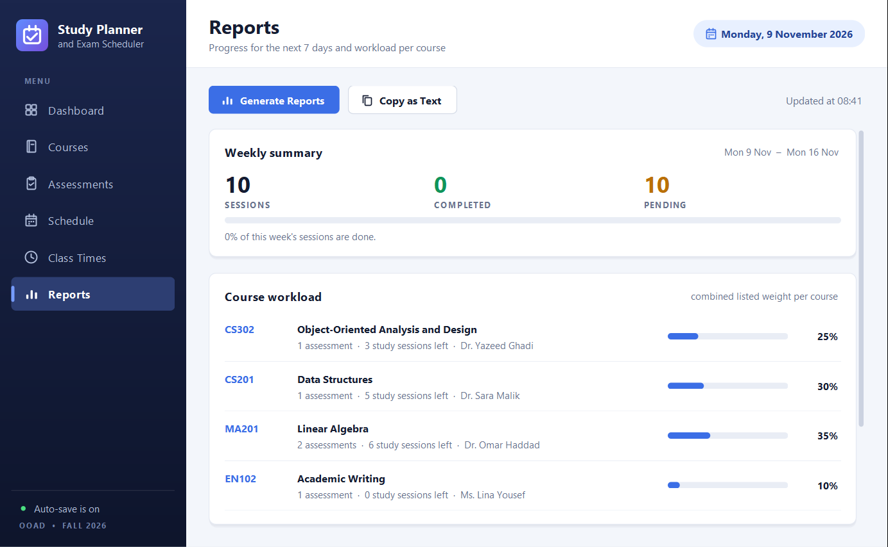
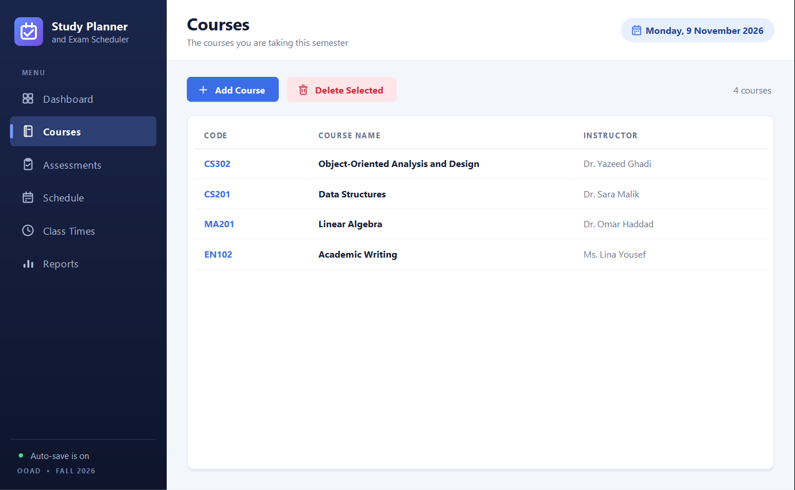
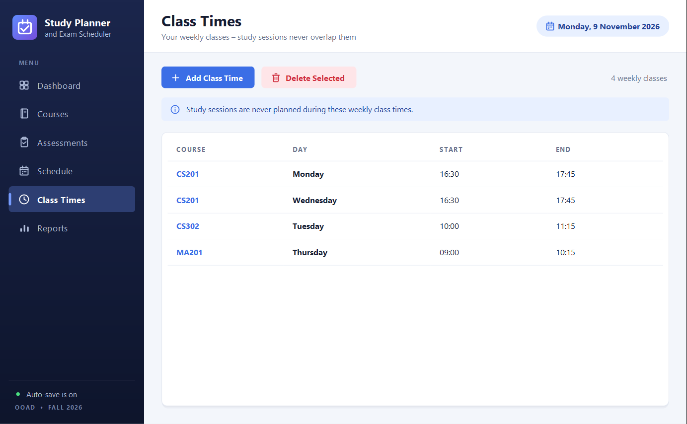
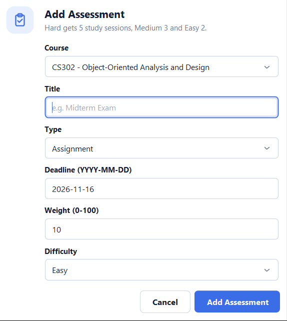

# Study Planner and Exam Scheduler — OOAD Fall 2026

## Group
- Ahmed Khaled — 202310947
- Ahmad Hamdan — 202310519
- Firas Elhag — 202310264
- Bilal Feroz Khan — 202310641

Instructor: Dr. Yazeed Ghadi

## Technology
Java 8+, NetBeans, Java Swing, local serialized file storage.

## Repository layout
```
src/studyplanner/Main.java          the whole application (model, service, persistence, Swing UI)
test/studyplanner/ServiceTest.java  automated checks of the service and persistence layers
uml/                                use case, sequence, activity and class diagrams (PNG + PlantUML source)
docs/Study_Planner_OOAD_Report.docx term report: Part A analysis (SRS), Part B design, Part C final report
docs/SAD_Analysis_Document_SRS.docx earlier analysis document draft (see "Status" below)
docs/Project_Description_OOAD_Fall_2026.pdf  course project brief
docs/BUILD_CHECK.txt                build / test run log
docs/screenshots/                   screenshots of every page of the running app (demo data)
```

## Run from the command line
    mkdir out
    javac -encoding UTF-8 -d out src/studyplanner/Main.java
    java -cp out studyplanner.Main

## Run in NetBeans
1. Create a Java with Ant application named `StudyPlannerOOAD`.
2. Create package `studyplanner`.
3. Copy `src/studyplanner/Main.java` into that package.
4. Set `studyplanner.Main` as the Main Class.
5. Run the project.

Data is saved to `study-planner-data.ser` in the current user's home directory
(files from the earlier version of this prototype can still be loaded).

## Run the automated tests (command line, no GUI)
    mkdir out
    javac -encoding UTF-8 -d out src/studyplanner/Main.java test/studyplanner/ServiceTest.java
    java -cp out studyplanner.ServiceTest

The 24 checks cover study-plan generation, conflict detection and saving/loading.

## Features in this prototype
- Add/delete courses (deleting a course also deletes its class times).
- Add/delete assignments, quizzes, and exams with deadline, weight, and difficulty.
- Add/delete recurring weekly class meeting times.
- Generate weekday study sessions in three one-hour slots (5, 6 and 7 PM), spread evenly before each deadline
  (never on the deadline day), avoiding class times and occupied slots; generating again adds no duplicates and
  plans missed sessions again.
- Detect same-date exams, class-time overlaps, and days with more than three pending sessions.
- Mark study sessions completed.
- Dashboard counts, due-soon and overdue flags.
- Weekly progress and per-course assessment workload report.
- Automatic local save after changes; a damaged data file is kept as `.corrupt` and the user is warned.

## Screenshots (demo data, 2026-11-09)
| Dashboard | Schedule |
|---|---|
|  |  |
| **Assessments** | **Reports** |
|  |  |
| **Courses** | **Class Times** |
|  |  |
| **Add Assessment form** | |
|  | |

## UI/UX update (branch `ui-ux-polish`)
Only the look of the window (`PlannerFrame`) changed; the planning rules and saving did not.
- Modern theme: dark gradient sidebar with icons and a highlighted current page, page subtitles, today's date,
  white rounded cards with soft shadows, one font (Segoe UI on Windows, Helvetica Neue on macOS).
- Dashboard: number cards with icons and short summaries, a completion progress bar, lists of upcoming deadlines
  (coloured OVERDUE / TODAY / IN 3 DAYS tags), the next study sessions and the scheduling warnings in plain language.
- Tables: no grid, roomy rows, hover highlight, coloured tags for status, type and difficulty, readable dates
  ("Mon 9 Nov 2026"), today's sessions and close or overdue deadlines highlighted, past unfinished sessions shown as
  "Missed", and a friendly message when a table is empty.
- Forms: rounded fields with placeholders, the cursor starts in the first field, Enter confirms and Escape cancels.
- Feedback: short confirmation messages ("toasts") after every change, a "saved" indicator in the sidebar, and a
  confirmation before anything is deleted.
- Reports page: weekly summary with a progress bar, a workload bar per course and the conflicts list;
  "Copy as Text" copies the plain-text report.
- Extras: double-click a session to mark it complete, the Delete key deletes the selected row, the window size fits
  small laptop screens.

Not changed (so the report, UML diagrams and test plan stay valid):
- `Main`, `Course`, `Assessment`, `StudySession`, `ClassMeeting`, `PlannerData`, `DataStore` and `PlannerService` are
  byte-for-byte the same as on `main`; the class diagram's classes, fields and `PlannerFrame` methods all still exist.
- `uml/`, the report, the SRS, the course brief and `test/` are untouched; all 24 automated tests pass.
- Button, page and field names, validation messages and the data file are the same, so the user guide and the
  manual test plan in the report still apply, and data saved by the `main` version loads unchanged.
- Still one source file, plain Swing and Java 2D, no third-party libraries, Java 8 compatible, ASCII-only source.

## Status
Fixed on 2026-11-09:
- Dashboard counts always showed 0: `setStat()` looked for label name `"Courses"` while the labels are named
  `"stat:Courses"` etc. It now looks for `"stat:" + key` (FR-10).
- Damaged data file was not kept as `.corrupt` on Windows (1 automated test failed): `DataStore.load()` left the
  `FileInputStream` open when `ObjectInputStream` rejected the file, and Windows cannot rename an open file. The stream
  is now its own try-with-resources resource. All 24 automated tests pass on Windows.

Still open:
- Long warnings on the Dashboard are cut off (horizontal scroll) and the sidebar footer text is clipped.
- `docs/SAD_Analysis_Document_SRS.docx` describes a different design (hours split per day, `AcademicItem`
  subclasses, SQLite/JSON, three tabs) from the implemented one described in the report and the code.
- Manual GUI tests (report, Part C Section 3) are still "Not run yet"; group contributions and AI-use statement
  in the report are placeholders.

## Changes in this revision
See "Part C, Section 2" of the report. Main points: no duplicate sessions, no starvation of nearer deadlines,
sessions spread before the deadline, deleting an assessment removes the selected row, safe handling of a damaged
data file, formatted and commented code, automated tests, rendered UML diagrams.

## UML
`uml/` contains the four diagrams as PNG images (also placed in the report) and the PlantUML source files.
The PNG files were drawn with Graphviz and matplotlib from the same definitions. If the instructor requires a CASE
tool, recreate them from the `.puml` files in that tool and replace the pictures in the report.

## Known limitations
- Scheduler uses fixed slots and a simple heuristic, not an optimization algorithm.
- The overloaded-day warning cannot be triggered by generated sessions (at most three slots per day); it is a safeguard.
- Dashboard deadline flags are in-app reminders; operating-system notifications are not implemented.
- Single-user desktop application.
- Editing existing records, deleting single sessions, custom availability, and PDF/Excel export are not implemented.
- The GUI has not been run on a real screen by the reviewer: run the manual test plan (report, Part B Section 6) on the
  group's NetBeans setup and record the results in Part C, Section 3 before submission.
