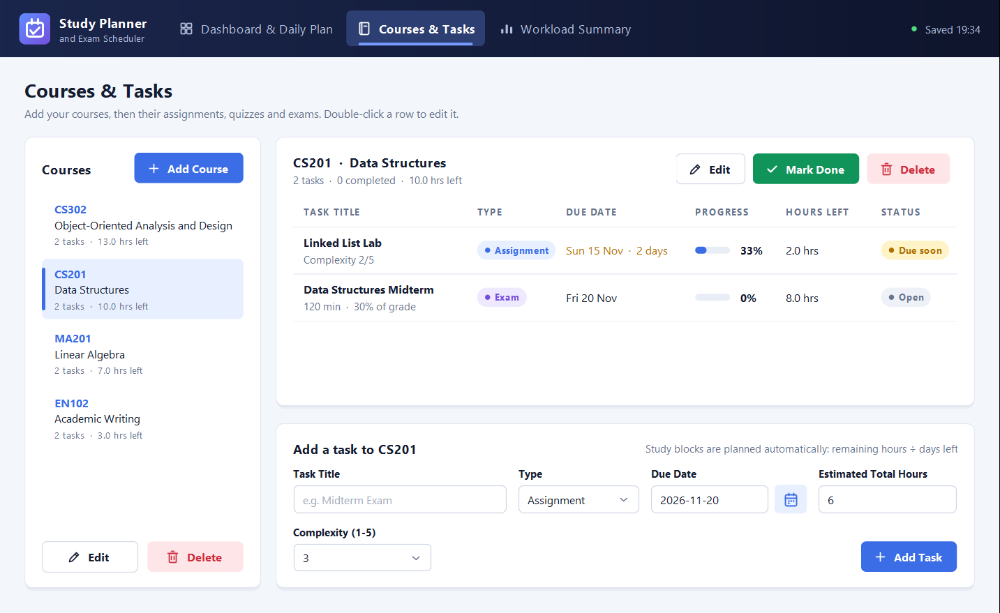
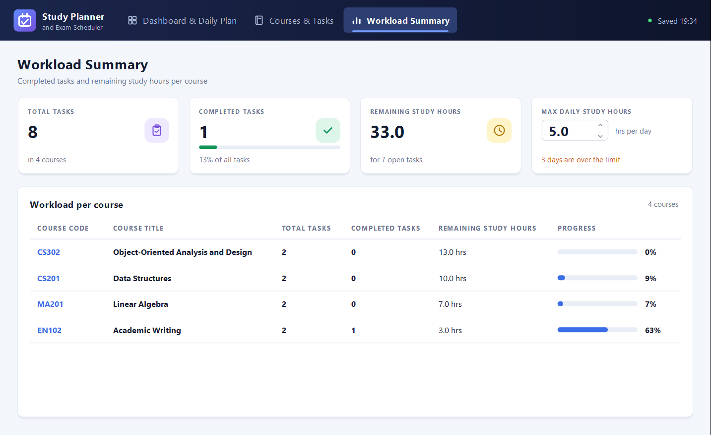
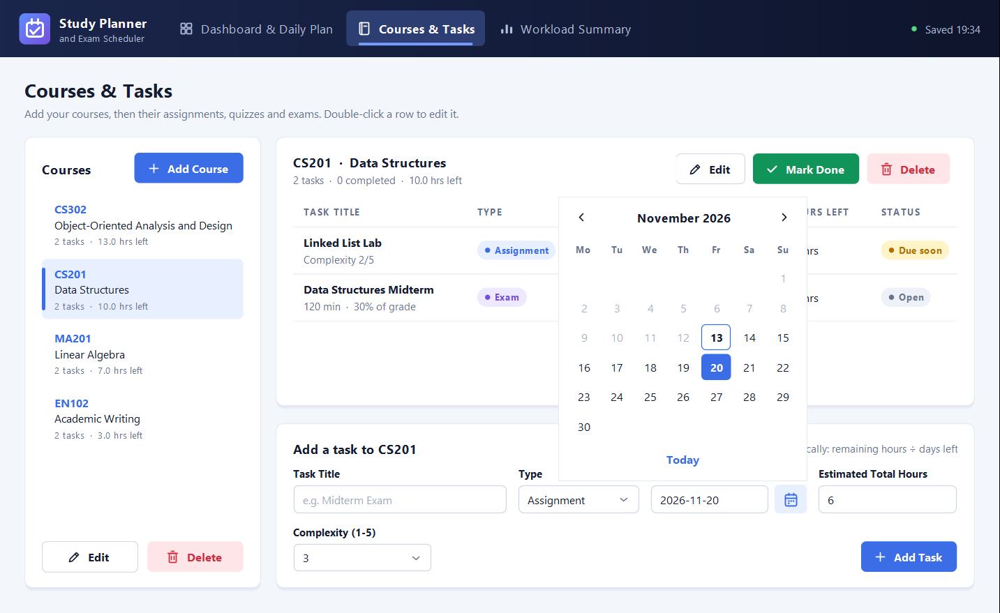
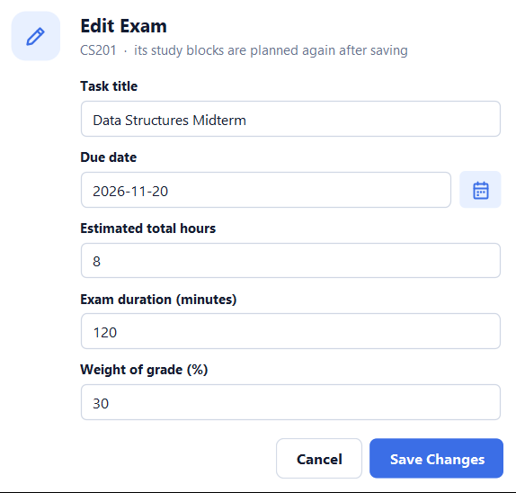

# Study Planner and Exam Scheduler — OOAD Fall 2026

## Group
- Ahmed Khaled — 202310947
- Ahmad Hamdan — 202310519
- Firas Elhag — 202310264
- Bilal Feroz Khan — 202310641

Instructor: Dr. Yazeed Ghadi

The program follows the **final analysis document**:
[`docs/FINAL VER Study Planner and Exam Scheduler Analysis Document .docx`](docs/)

## What it does
- **Courses and tasks (FR1, UC1, UC2)** — add, view, edit and delete courses (code and title) and their
  assignments, quizzes and exams: title, due date, estimated total study hours, plus the type's own field
  (assignment complexity 1-5, quiz chapter, exam duration and weight).
- **Daily study blocks (FR2, UC3)** — whenever a task is added or changed, its remaining hours are divided by the
  calendar days left, giving one study block per day and no clock times. *Generate Schedule* plans everything again
  from today; the plan is also refreshed every time the app opens.
- **Conflicts (FR3, UC4)** — `Conflict Warning: 2 Exams scheduled on 2026-11-20` and
  `Overload Warning: Nov 18 requires 6.5 hrs, passing your 5.0 hr daily limit`. The daily limit (5.0 h by default)
  is a number box on the Workload Summary tab.
- **Progress (FR4, UC5)** — tick a block's *Mark Complete* box on the dashboard and its hours come off the task's
  remaining hours (untick to undo). Overdue tasks are shown in red, tasks due within 3 days in yellow.
- **Workload summary and saving (FR5, UC6)** — total tasks, completed tasks and remaining study hours per course.
  Everything is saved automatically to `data/study-planner.json` inside the project folder.

## Screens (section 5.4: one window with three tabs)
| Dashboard & Daily Plan | Courses & Tasks |
|---|---|
|  |  |
| **Workload Summary** | **Due date picker** |
|  |  |
| **Edit task form** | |
|  | |

Screenshots use demo data (13 November 2026).

## Code structure (section 4: separate packages for interface, logic and storage)
| Package | Classes | Role |
|---|---|---|
| `studyplanner.model` | `Course`, `AcademicItem` (abstract), `Assignment`, `Quiz`, `Exam`, `StudyBlock` | entity classes |
| `studyplanner.engine` | `ScheduleEngine` | control: scheduling and conflict checks |
| `studyplanner.storage` | `StorageManager`, `Json` | boundary: the JSON data file |
| `studyplanner.ui` | `MainDashboard`, `DatePicker`, `Ui` | user interface (Swing) |
| `studyplanner` | `Main` | starts the program |

### Where the document's design is in the code
| Analysis document | Code |
|---|---|
| `Course`: `addAcademicItem`, `getRemainingCourseHours`, `getCompletedTaskCount`; composition with `AcademicItem` | `src/studyplanner/model/Course.java` |
| `AcademicItem` «abstract»: `getRemainingHours`, `calculateDailyHours(today)`, `markCompleted`, `getItemCategory` {abstract} | `src/studyplanner/model/AcademicItem.java` |
| `Assignment`, `Quiz`, `Exam`: `getItemCategory`, `calculateDailyHours(today)` (inheritance and polymorphism) | `src/studyplanner/model/` |
| `StudyBlock`: `markBlockDone` | `src/studyplanner/model/StudyBlock.java` |
| `ScheduleEngine`: `generateDailyBlocks`, `detectConflicts`; sequence 1: `generateSchedule`, `divideHoursAcrossDays`, `detectDateConflicts`; sequence 2: `markBlockComplete` | `src/studyplanner/engine/ScheduleEngine.java` |
| `StorageManager`: `saveAll`, `loadAll`; sequences: `saveItem` (confirmSaved), `getCoursesAndTasks` (taskList), `updateProgress` | `src/studyplanner/storage/StorageManager.java` |
| `UI: MainDashboard`: `addAcademicItem`, `requestGenerateSchedule`, `displayScheduleAndAlerts` | `src/studyplanner/ui/MainDashboard.java` |

`uml/` holds the document's three diagrams (PNG) with PlantUML sources (`*.puml`), including sequence 2.
The diagrams of the earlier slot-based design are kept in `uml/old-design/`.

### Decisions the document leaves open
- **JSON file, not SQLite.** `sqlite-jdbc` is a third-party library, which the course brief allows only with the
  instructor's consent. A small JSON reader and writer (`storage/Json.java`) keeps the program free of libraries.
- **Days left per item type (polymorphism).** An assignment can still be worked on during its due date; a quiz or an
  exam is sat on its due date, so its hours are spread over the days before it.
- **Planning again.** Blocks that are already done are kept as history and open blocks are replaced. If today's block
  of a task is already done, its new plan starts tomorrow.
- **Overload check.** Today counts all of today's blocks; later days count only blocks that are not done yet.
- **Undo.** A ticked block can be unticked, and a task can be marked done early and reopened.
- **Damaged data file.** It is kept as `data/study-planner.json.corrupt` and the app starts empty with a warning.

## Run (JDK 17 or later)
### NetBeans
1. *File → New Project → Java with Ant → Java Project with Existing Sources*.
2. Project folder: this repository. Source Package Folders: `src`. Test Package Folders: `test`.
3. *Project Properties → Run → Main Class*: `studyplanner.Main`, then run the project.

The data is saved in `data/study-planner.json` inside the project folder (the folder is not committed).

### Command line
Git Bash, macOS or Linux:

    javac -encoding UTF-8 -d out $(find src -name "*.java")
    java -cp out studyplanner.Main

Windows PowerShell:

    javac -encoding UTF-8 -d out (Get-ChildItem -Recurse src -Filter *.java).FullName
    java -cp out studyplanner.Main

## Automated tests (no GUI, no test framework)
    javac -encoding UTF-8 -d out $(find src -name "*.java") test/studyplanner/PlannerTest.java
    java -cp out studyplanner.PlannerTest

The 47 checks cover the hours-per-day rule of each item type, block generation, ticking and unticking blocks,
completing tasks, same-day exams, the daily limit, validation, saving and loading (including damaged files) and the
one-second performance requirement for 10 courses and 100 items.

## Repository layout
```
src/studyplanner/          Main and the model, engine, storage and ui packages
test/studyplanner/         PlannerTest (automated checks)
uml/                       final diagrams (PNG + PlantUML); uml/old-design/ has the earlier ones
docs/                      final analysis document, earlier report and SRS draft, course brief, build log, screenshots
```

## Status
- Implemented: everything in the final analysis document (FR1-FR5, UC1-UC6, the three tabs of section 5.4).
- `docs/Study_Planner_OOAD_Report.docx` (design document, final report, user guide, test plan) and
  `docs/SAD_Analysis_Document_SRS.docx` still describe the earlier slot-based design and need updating to match.
- Not checked yet: the look on macOS and Linux, and a manual test pass in NetBeans by the group.
